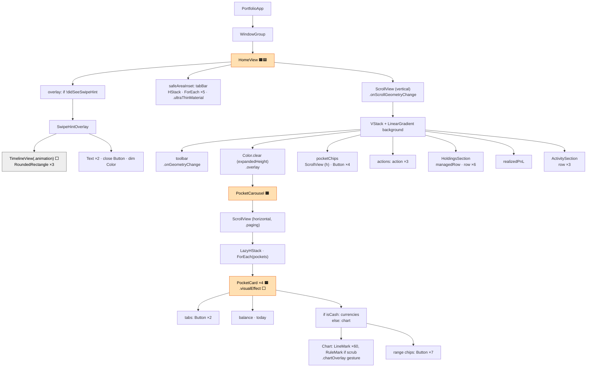
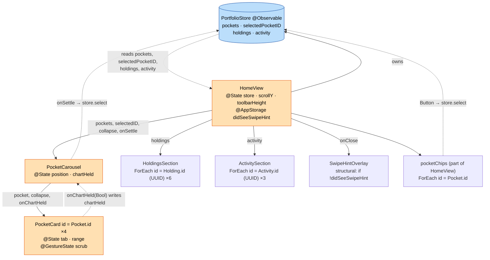
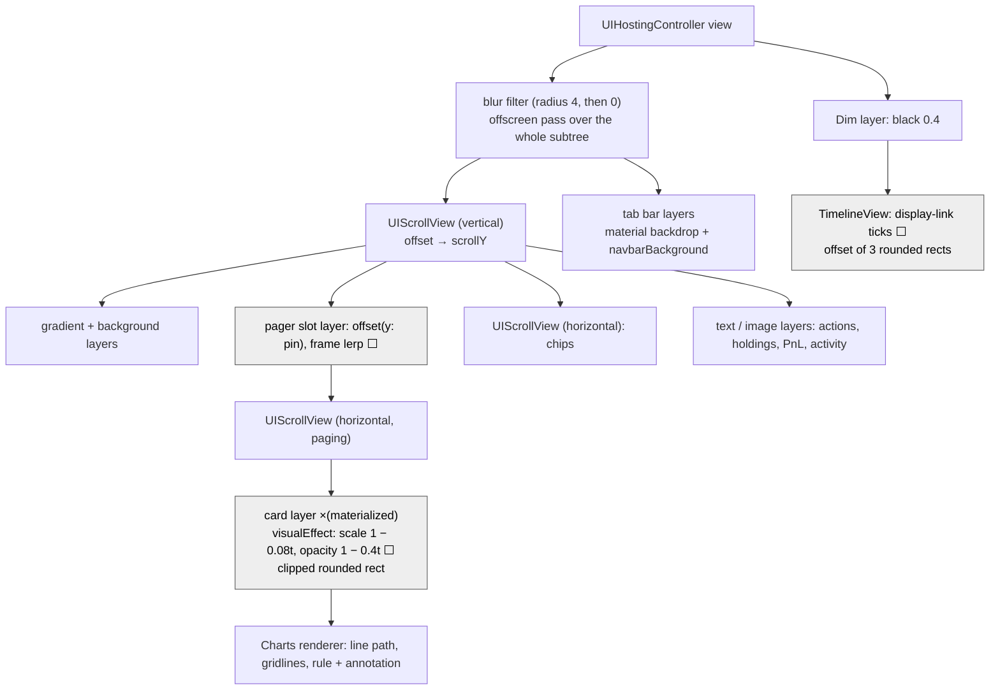
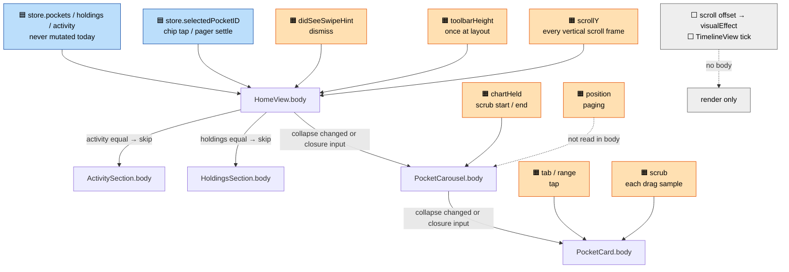

# Home screen trees

The portfolio home screen (`HomeView`) as implemented, drawn as SwiftUI's three layers, with the state that drives re-evaluation marked on each.

| Flutter term | SwiftUI equivalent used here |
|---|---|
| Widget tree | **View tree**: `View` value structs |
| Element tree | **Attribute graph**: identity, `@State` storage, dependencies |
| Render tree | **Render tree**: platform views, layers and drawing |
| `setState` | `@State` / `@GestureState` / `@AppStorage` write |
| `BlocBuilder` | A body that reads an `@Observable` store property |

**Legend** (used in every diagram)

- 🟧 **Local state**: `@State`, `@GestureState`, `@AppStorage`. A write re-runs the body of the view that owns it, if that body read it.
- 🟦 **Store read**: `@Observable PortfolioStore`. Tracking is per property: a body re-runs only when a property it *read* changes.
- ⬜ **Render-only**: changes per frame without re-running any `body` (`visualEffect`, scroll geometry, TimelineView ticks).

## 1. View tree

`View`s are cheap value descriptions. SwiftUI builds them again on every `body` call and then throws them away (like Flutter widgets). The private computed properties in `HomeView` (`toolbar`, `pocketChips`, `actions`, `realizedPnL`, `tabBar`) are not separate views. They are inlined into `HomeView.body`, so they re-run whenever it does.

## 2. Attribute graph / identity tree

SwiftUI's persistent layer (like Flutter's element tree). Nodes are keyed by **identity**. Most identity is *structural*: the node's position in the `body` result, including which branch of an `if` it sits in. Inside a `ForEach`, identity is *explicit*, taken from the element ids. `@State` storage hangs off the identity, so it survives re-evaluation and is destroyed when the identity goes away. Edges show which state or store property each body reads.

Identity notes:

- `PocketCard` sits in a `LazyHStack`, so its node is created when the page first scrolls near the viewport. `tab` and `range` are keyed by `Pocket.id`, which means they belong to a pocket, not a page slot.
- Inside `PocketCard`, `if isCash { currencies } else { chart }` gives the two branches separate structural identities. A pocket never switches branch.
- Ids that are explicit but not data-backed: `tabs` (`\.offset`), range chips (`\.self`), tab bar (`\.0`), chart points (`\.offset`), hint cards (`0..<3`).
- `SwipeHintOverlay` is created and destroyed by the `if`. The `.transition(.opacity)` animates the removal.
- `HomeView.body` never reads `toolbarHeight` directly. It reads it through `pin` → `collapse` → `pageGrey`, and the same chain carries `scrollY`.
- `PocketCarousel.body` passes `$position` to `.scrollPosition` and reads `position` only inside the `onChange` and `onScrollPhaseChange` closures. The body itself never reads it, so writes made by paging do not re-run the body.

## 3. Render tree

This is what actually draws. SwiftUI flattens most views into its own display list, which is drawn into CALayers. Only a few nodes are backed by real platform objects.

- **ScrollViews**: on the iOS 18 target, all three (`HomeView` vertical, `PocketCarousel` paging, `pocketChips`) are `UIScrollView`-backed. Scrolling moves the content layers without re-running any `body`.
- **`visualEffect`** runs its closure against the card's current frame in the scroll view at render time. The scale and fade come from geometry alone and never invalidate a `body`.
- **`opacity` on a card** fades the composited layer, so overlapping subviews do not show through each other.
- **`.blur`** forces an offscreen render pass over the whole screen while the hint is up. After dismissal the radius is 0 and the blur effectively does nothing.
- **`TimelineView(.animation)`** is driven by a display link. Each tick re-runs only its content closure, not `SwipeHintOverlay.body`.

## 4. Re-evaluation map

| Trigger | Bodies that re-run | Skipped (equal `let` inputs) |
|---|---|---|
| 🟧 Vertical scroll → `scrollY` | `HomeView` (whole body, including the inlined chips, actions and tab bar). `PocketCarousel` and visible `PocketCard`s re-run while `collapse` is changing (0 < pin < 328pt) | `HoldingsSection`, `ActivitySection` |
| 🟧 `toolbarHeight` (first layout) | `HomeView` | sections |
| 🟦 `select(_:)` (chip tap or pager settle) | `HomeView` (it reads `selectedPocketID`) → `PocketCarousel` (new `selectedID`, so `onChange` animates `position`) | `PocketCard`s (same `pocket`/`collapse`), sections |
| 🟧 `didSeeSwipeHint` = true | `HomeView`. The overlay is removed and the blur goes to 0 | sections |
| 🟧 `chartHeld` (scrub starts or ends) | `PocketCarousel` (`.scrollDisabled`) | Cards: only if SwiftUI treats the new `onChartHeld` closure as changed |
| 🟧 `scrub` (drag on chart) | One `PocketCard`: tabs, balance, and `Chart` with all 60 `LineMark`s | other cards |
| 🟧 `tab` / `range` (tap) | One `PocketCard` | other cards |
| 🟧 `position` (paging) | none: the body doesn't read it | — |
| ⬜ Horizontal paging offset | none: `visualEffect` only | all |
| ⬜ TimelineView tick | only the `TimelineView` closure | `SwipeHintOverlay.body` |

How skipping works: when a parent re-runs, SwiftUI compares each child's stored properties with the previous values. If every input is equal, the child's body does not run. Closure inputs (`onSettle`, `onChartHeld`, `onClose`) cannot be compared, so a child that takes one may re-run whenever its parent does.

## 5. Hotspots and honest notes

1. **`scrollY` sits on `HomeView`, so the whole screen re-evaluates on every vertical scroll frame.** Its body reads `scrollY` (through `pin`, `collapse` and `pageGrey`). Every scroll frame therefore rebuilds the toolbar, chips, actions, PnL and tab bar descriptions, and diffs the sections. `PocketCarousel` and the visible cards follow while `collapse` changes, and possibly beyond that because of the closure inputs. Past full collapse, `pin` keeps changing, so `HomeView` keeps re-running even though nothing visible depends on it except the background offset.
   *Fix (not applied):* move the scroll-driven pieces (the pager slot and the `pageGrey` backgrounds) into a small child view that owns `scrollY`. Alternatively, derive the offset and fade inside `visualEffect` or `onScrollGeometryChange`, so only that subtree is invalidated. Even better, store only the clamped `collapse`, which stops changing outside the 0…328pt band.
2. **`scrub` rebuilds the whole `PocketCard`, chart included, on every scrubbed index change.** *Fix:* extract `chart` into its own view that owns `@GestureState scrub`. Tabs and balance would then skip.
3. **Closure inputs defeat diffing.** `onSettle: store.select`, `onChartHeld: { chartHeld = $0 }` and `onClose` are new closures on every parent body run.
4. **Pure functions of scroll position** (per the motion spec): the pager scale and fade (`pageProgress` → `visualEffect`, render-only) and the header collapse (`collapseProgress(pin)` → height, radius, padding and `bodyOpacity`). Both are deterministic in the offset with no animation state, so scrolling back exactly reverses them. The collapse is computed through a `body`, which is cause #1. The pager effect is not.
5. **Matches the stated state list.** The only nuances: `pocketChips` also reads the store and calls `select` (it is inlined in `HomeView`), and `PocketCarousel.position` is never read in its body.
